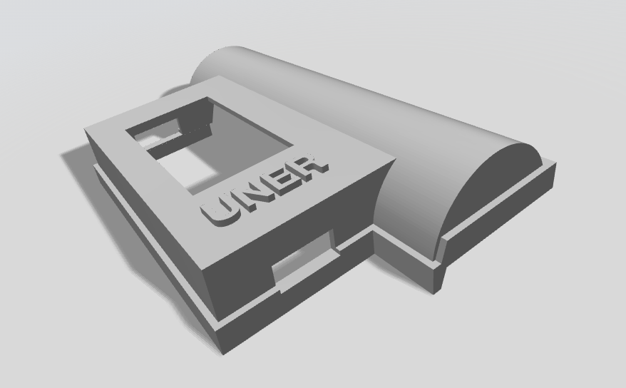
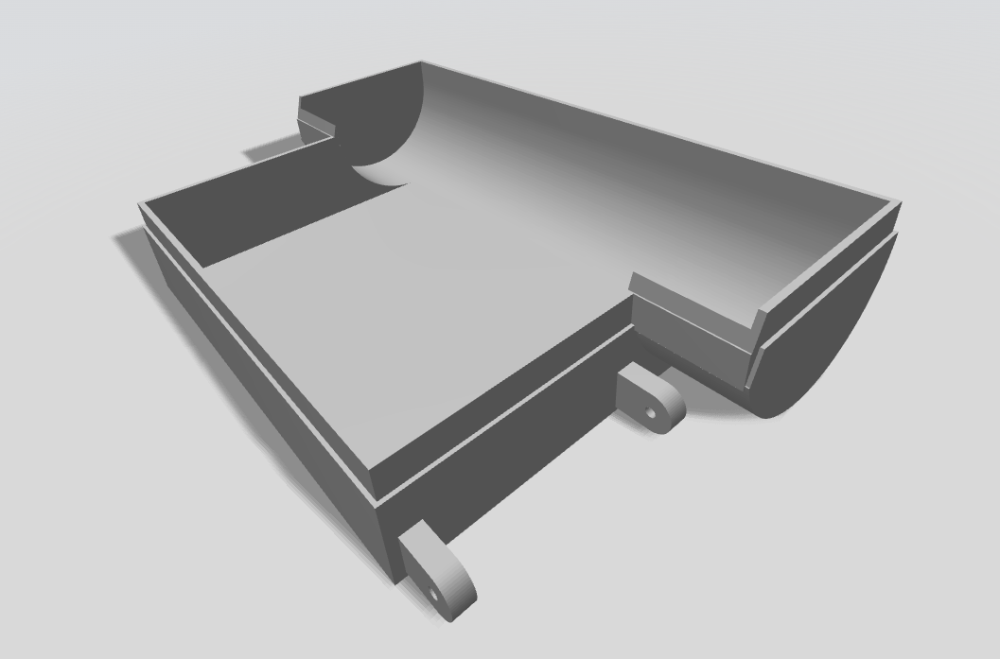

# Carcasa para dispositivo de monitoreo cardíaco

Carcasa diseñada para un dispositivo de monitoreo cardíaco mediante fotopletismografía (PPG). El diseño está compuesto por dos piezas, disponibles en formato STL para impresión 3D.

## Descargar los modelos

- **[Tapa superior — Carcasa_PPG_tapa.stl](Carcasa_PPG_tapa.stl)**
- **[Base — Carcasa_PPG_base.stl](Carcasa_PPG_base.stl)**

## Imágenes de la carcasa

| Tapa superior | Base |
|:---:|:---:|
|  |  |
